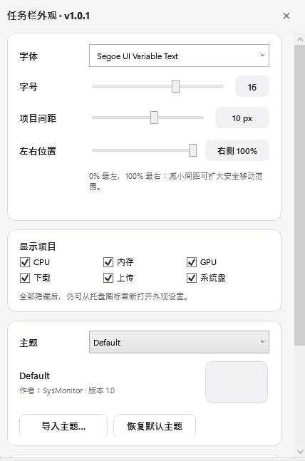
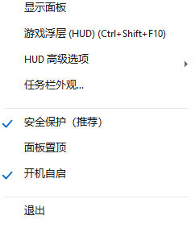

# SysMonitor — Windows Taskbar Monitor and Game FPS Overlay

[简体中文](README.md)

[](https://github.com/Oscar9527/SysMonitor/releases/latest)
[](LICENSE)
[](https://github.com/Oscar9527/SysMonitor)

SysMonitor is a portable system monitor for Windows 10 and 11. It puts CPU, GPU, memory, network, and disk metrics on the Windows taskbar. Click the monitor strip for a detailed view, or press `Ctrl+Shift+F10` to toggle the game FPS overlay.

## Download

Get the current build from [GitHub Releases](https://github.com/Oscar9527/SysMonitor/releases/latest).

- [Standalone v1.0.10](https://github.com/Oscar9527/SysMonitor/releases/download/v1.0.10/SysMonitor-v1.0.10-Standalone.exe) includes the .NET runtime. Download and run the single EXE.
- [Light v1.0.10](https://github.com/Oscar9527/SysMonitor/releases/download/v1.0.10/SysMonitor-v1.0.10-Light.exe) is smaller and requires the x64 .NET 8 Desktop Runtime.
- [SHA-256 checksums](https://github.com/Oscar9527/SysMonitor/releases/download/v1.0.10/SHA256SUMS-v1.0.10.txt) are available for both downloads.

To upgrade, exit the previous version and run the new EXE. Your settings are stored in `%APPDATA%\SysMonitor\settings.json`.

## Features

- **Taskbar monitor** displays CPU and GPU usage and temperatures, RAM usage, upload and download rates, and system drive usage. It follows the taskbar layout, handles display scaling and auto-hide, and stays out of Alt+Tab.
- **Details panel** shows the last 60 seconds of CPU and GPU usage alongside per-drive storage information.
- **Game overlay** displays FPS and hardware metrics in horizontal or vertical layouts. It follows the selected game window and can remember a position for each display.
- **Appearance settings** let you change the font, size, spacing, and position of the taskbar monitor and choose which metrics are visible. Day and night themes are available.
- **Tray menu** provides quick access to appearance and overlay settings, startup options, and the option to keep the details panel on top.

### FPS and hardware readings

The overlay uses a usable RTSS sample when available and falls back to the bundled PresentMon collector, which reads Windows ETW events. Some older DirectDraw games and unusual rendering paths may not report FPS. GPU metrics depend on the hardware, driver, and available sensors.

The main app runs without elevation. Some hardware sensors or PresentMon capture sessions may request administrator access through a helper process. Affected readings remain unavailable if access is declined.

## Screenshots

**Taskbar appearance settings**



**System tray menu**



## What's new in v1.0.10

- Added day and night themes and redesigned the details panel, tray menu, and settings windows.
- Fixed the stray strip that could remain on the desktop after minimizing the details panel.
- Fixed clipped taskbar monitor text at 125% scaling.

[Release notes and earlier versions](https://github.com/Oscar9527/SysMonitor/releases)

## Build from source

On Windows x64, install the .NET 8 SDK or later and run this from the repository root:

```powershell
.\Launcher\Build-Release.ps1
```

The script writes the Light and Standalone EXEs to `artifacts\`. See [the launcher documentation](Launcher/README.md) for build details.

## License

SysMonitor is released under the [MIT License](LICENSE). See the [third-party notices](SysMonitor/THIRD-PARTY-NOTICES.md) for bundled dependencies.
