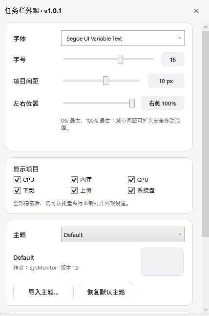
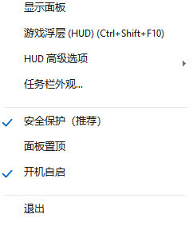

<div align="center">


# SysMonitor

**Windows 任务栏系统监控与游戏 FPS HUD**

<p><b>简体中文</b> · <a href="README.en.md">English</a></p>

[](https://github.com/Oscar9527/SysMonitor/releases)
[](https://github.com/Oscar9527/SysMonitor)
[](https://dotnet.microsoft.com/)
[](LICENSE)

<p>
  <a href="#核心特性">核心特性</a> ·
  <a href="#界面预览">界面预览</a> ·
  <a href="#下载与运行">下载与运行</a> ·
  <a href="#快速上手">快速上手</a> ·
  <a href="#更新日志">更新日志</a> ·
  <a href="#本地构建">本地构建</a>
</p>

</div>

**SysMonitor** 是一款轻量、便携的 Windows 10/11 任务栏性能监视器与游戏帧率浮层（HUD）工具，将 CPU、内存、GPU、温度、网络速率与系统盘占用无缝嵌入任务栏，并提供圆角详情面板与可定制的游戏内实时浮层。

---

## 核心特性

- **任务栏状态栏（Taskbar Band）**：透明无边框嵌入 Windows 任务栏，实时显示 CPU/GPU 占用与温度、内存、上传/下载速率与系统盘占用；自动适配任务栏布局、DPI 缩放与自动隐藏，不抢焦点、不占 `Alt+Tab`。
- **圆角详情面板（Detail Panel）**：点击任务栏监控条在正上方弹出，提供 Telegram Day / Night 双主题配色、最近 60 秒 CPU/GPU 曲线、双列圆角存储分区卡片与 5px 极细圆角滚动条。
- **游戏监控浮层（HUD）**：
  - `Ctrl+Shift+F10` 全局快捷键随时开启/隐藏；
  - 提供 MSI Afterburner 单行纯色风格与 `Consolas` 字体预设，支持垂直 / 水平排版、顶部左/中/右预设对齐与像素级微调，多显示器坐标独立记忆；
  - 全局显示器基准定位并自动过滤浏览器与常规桌面工具，适配全屏、窗口化与切屏场景；
  - **双通道帧率引擎**：优先使用可用的 RTSS 共享内存采样，否则回退至内嵌 PresentMon 2.5.1 ETW 采集；仅在目标产生可观察的呈现事件时显示 FPS，旧式 DirectDraw 或特殊渲染路径可能无数据。
- **按需采样与自然内存管理**：隐藏 HUD 时停用详细频率遥测，界面仅消费最新快照；交由 .NET GC 正常管理内存，不使用周期性强制 GC 或工作集裁剪。
- **免安装便携运行**：主程序无需常驻管理员权限；部分受限硬件传感器或 ETW 采集场景按需通过受控助手请求提升权限。

<details>
<summary><b>查看完整功能与监控指标矩阵</b></summary>

| 模块 | 功能与指标说明 |
| :--- | :--- |
| **任务栏 Band** | 透明无边框置顶显示，自动适应任务栏位置、DPI 缩放与自动隐藏任务栏 |
| **CPU 监控** | 总体使用率、逻辑处理器数量、CPU 核心温度 |
| **内存监控** | 物理内存使用率、已用 / 总容量 |
| **GPU 监控** | 在驱动和采集后端提供数据时，显示 NVIDIA / AMD / Intel GPU 利用率、温度与显存占用 |
| **网络监控** | 活动 IPv4 网卡合计实时下载与上传速率 |
| **存储监控** | 任务栏显示系统盘占用，详情面板自适应展示所有分区容量与占用进度 |
| **历史曲线** | 详情面板呈现最近 60 秒 CPU / GPU 连续使用率曲线 |
| **游戏 HUD** | `Ctrl+Shift+F10` 全局热键、垂直 / 水平排版、预设对齐与每显示器精确坐标记忆 |
| **外观定制** | 自定义字体、字号、间距 `0–18px`、左右位置、按项显示/隐藏、Day / Night 主题与多语言支持 |
| **资源策略** | 按显示状态启停详细采样，合并待处理 UI 快照 |

</details>

---

## 界面预览

<table>
  <tr>
    <td align="center" valign="top" width="58%">
      
      <br />
      <sub><b>任务栏外观与个性化</b><br />自定义字体、字号、间距、显示项目与主题色彩</sub>
    </td>
    <td align="center" valign="top" width="42%">
      
      <br />
      <sub><b>系统托盘右键菜单</b><br />快捷切换浮层、安全保护模式、开机自启与面板置顶</sub>
    </td>
  </tr>
</table>

---

## 下载与运行

前往 [GitHub Releases](https://github.com/Oscar9527/SysMonitor/releases/tag/v1.0.11) 下载最新正式版 **v1.0.11**（提供 [`SHA256SUMS-v1.0.11.txt`](https://github.com/Oscar9527/SysMonitor/releases/download/v1.0.11/SHA256SUMS-v1.0.11.txt) 校验文件）：

| 发行版本 | 下载文件 | 运行要求与说明 |
| :--- | :--- | :--- |
| **独立免安装单文件版（推荐）** | [`SysMonitor-v1.0.11-Standalone.exe`](https://github.com/Oscar9527/SysMonitor/releases/download/v1.0.11/SysMonitor-v1.0.11-Standalone.exe) | 内置完整 .NET 运行时，双击即开即用，无需安装任何前置依赖 |
| **轻量单文件版** | [`SysMonitor-v1.0.11-Light.exe`](https://github.com/Oscar9527/SysMonitor/releases/download/v1.0.11/SysMonitor-v1.0.11-Light.exe) | 体积更小，需 x64 .NET 8 Desktop Runtime；缺失时自动提示并可一键打开微软官方下载 |

> [!TIP]
> 升级版本时，先退出正在运行的旧版本再启动新 EXE 即可；用户配置保存在 `%APPDATA%\SysMonitor\settings.json`。

<details>
<summary><b>历史版本归档（v1.0.1 – v1.0.10）</b></summary>

| 版本 | 发布说明与特性 | 独立版下载 (Standalone) | 轻量版下载 (Light) |
| :--- | :--- | :--- | :--- |
| **v1.0.10** | [Release](https://github.com/Oscar9527/SysMonitor/releases/tag/v1.0.10) · Telegram Day/Night 界面重构、全面稳定性修复与 125% DPI 裁切修正 | [`Standalone`](https://github.com/Oscar9527/SysMonitor/releases/download/v1.0.10/SysMonitor-v1.0.10-Standalone.exe) | [`Light`](https://github.com/Oscar9527/SysMonitor/releases/download/v1.0.10/SysMonitor-v1.0.10-Light.exe) |
| **v1.0.9** | [Release](https://github.com/Oscar9527/SysMonitor/releases/tag/v1.0.9) · 任务栏监控条异常消失自动恢复、慢速探测防打断、兼容任务栏自动隐藏 | [`Standalone`](https://github.com/Oscar9527/SysMonitor/releases/download/v1.0.9/SysMonitor-v1.0.9-Standalone.exe) | [`Light`](https://github.com/Oscar9527/SysMonitor/releases/download/v1.0.9/SysMonitor-v1.0.9-Light.exe) |
| **v1.0.8** | [Release](https://github.com/Oscar9527/SysMonitor/releases/tag/v1.0.8) · 任务栏切屏定位修正与遥测后端选择优化 | [`Standalone`](https://github.com/Oscar9527/SysMonitor/releases/download/v1.0.8/SysMonitor-v1.0.8-Standalone.exe) | [`Light`](https://github.com/Oscar9527/SysMonitor/releases/download/v1.0.8/SysMonitor-v1.0.8-Light.exe) |
| **v1.0.7** | [Release](https://github.com/Oscar9527/SysMonitor/releases/tag/v1.0.7) · 降低辅助进程内存占用、有界缓存与任务栏事件合并 | [`Standalone`](https://github.com/Oscar9527/SysMonitor/releases/download/v1.0.7/SysMonitor-v1.0.7-Standalone.exe) | [`Light`](https://github.com/Oscar9527/SysMonitor/releases/download/v1.0.7/SysMonitor-v1.0.7-Light.exe) |
| **v1.0.6** | [Release](https://github.com/Oscar9527/SysMonitor/releases/tag/v1.0.6) · 全面审计、并发与生命周期修复、双版本发布 | [`Standalone`](https://github.com/Oscar9527/SysMonitor/releases/download/v1.0.6/SysMonitor-v1.0.6-Standalone.exe) | [`Light`](https://github.com/Oscar9527/SysMonitor/releases/download/v1.0.6/SysMonitor-v1.0.6-Light.exe) |
| **v1.0.5** | [Release](https://github.com/Oscar9527/SysMonitor/releases/tag/v1.0.5) · 功耗监测、矩阵式项目定制、单文件压缩与 DPI 调整 | [`Standalone`](https://github.com/Oscar9527/SysMonitor/releases/download/v1.0.5/SysMonitor-v1.0.5-Standalone.exe) | [`Light`](https://github.com/Oscar9527/SysMonitor/releases/download/v1.0.5/SysMonitor-v1.0.5-Light.exe) |
| **v1.0.4** | [Release](https://github.com/Oscar9527/SysMonitor/releases/tag/v1.0.4) · 窗口化游戏边缘智能贴靠、窗口焦点自动同步、CPU 快速采样 | [`Standalone`](https://github.com/Oscar9527/SysMonitor/releases/download/v1.0.4/SysMonitor-v1.0.4-Standalone.exe) | [`Light`](https://github.com/Oscar9527/SysMonitor/releases/download/v1.0.4/SysMonitor-v1.0.4-Light.exe) |
| **v1.0.3** | [Release](https://github.com/Oscar9527/SysMonitor/releases/tag/v1.0.3) · 跟随系统深色/浅色自适应、暗色模式深度调优、中文字形渲染修复 | [`Standalone`](https://github.com/Oscar9527/SysMonitor/releases/download/v1.0.3/SysMonitor-v1.0.3-Standalone.exe) | [`Light`](https://github.com/Oscar9527/SysMonitor/releases/download/v1.0.3/SysMonitor-v1.0.3-Light.exe) |
| **v1.0.2** | [Release](https://github.com/Oscar9527/SysMonitor/releases/tag/v1.0.2) · 鼠标自由缩放与尺寸记忆、16px 圆角无黑边、多显示器副屏支持 | [`Standalone`](https://github.com/Oscar9527/SysMonitor/releases/download/v1.0.2/SysMonitor-v1.0.2-Standalone.exe) | [`Light`](https://github.com/Oscar9527/SysMonitor/releases/download/v1.0.2/SysMonitor-v1.0.2-Light.exe) |
| **v1.0.1** | [Release](https://github.com/Oscar9527/SysMonitor/releases/tag/v1.0.1) · 首发正式版、大字号排版与早期 DirectDraw 兼容尝试 | [`Standalone`](https://github.com/Oscar9527/SysMonitor/releases/download/v1.0.1/SysMonitor-v1.0.1-Standalone.exe) | [`Light`](https://github.com/Oscar9527/SysMonitor/releases/download/v1.0.1/SysMonitor-v1.0.1-Light.exe) |

</details>

---

## 快速上手

1. 下载 `SysMonitor-v1.0.11-Standalone.exe` 并双击运行。
2. 任务栏右侧将自动出现实时监控条，并在系统托盘生成图标。
3. **点击监控条**：在正上方弹出圆角详情面板。
4. **游戏浮层 HUD**：游戏内随时按下 `Ctrl+Shift+F10` 开启/隐藏实时监控。
5. **右键托盘图标**：打开外观设置、HUD 详细配置、切换安全保护模式或退出程序。

> [!NOTE]
> **关于 CPU 温度读取与管理员权限**
> - 软件界面可直接双击运行，通常无需让主进程常驻管理员权限。
> - 部分机器启动时 CPU 温度可能需要等待数秒才显示，这是系统限制非管理员权限直接读取硬件传感器、程序在后台安全适配所致。
> - 受限传感器或 PresentMon ETW 场景可能通过受控助手请求提升权限；拒绝提权时对应指标保持不可用，不会伪造或估算数据。

---

## 更新日志

### v1.0.11

- **全新应用图标设计**：重绘透明底圆角矩形（Squircle）应用与托盘图标，采用深曜石机身与青蓝渐变动效脉冲波形，同步打包 `16×16` 至 `256×256` 全尺寸规格。
- **项目主页排版优化**：居中 Hero 顶栏、双列界面预览与文档结构整理。

### v1.0.10

- **Telegram Desktop 风格界面重构**：全新 Telegram Day / Night 双主题配色，详情面板采用 Telegram Profile 顶栏、圆形指标头像徽章、双列圆角存储卡片与 5px 极细圆角滚动条，并同步统一托盘菜单与设置子窗口样式。
- **全面代码审查与稳定性修复**：修复遥测采集、帧率统计、任务栏定位、主题包加载、多实例启动及窗口生命周期中的潜在竞态与资源泄漏问题，并补充 6 组回归测试（共 482 项单元测试）。
- **交互与高 DPI 显示修复**：修复详情面板点击最小化后残留浮条问题（改为平滑隐藏并在状态变更时兜底）；修复 125% DPI 下 40px 任务栏监视条底部文字裁切问题；增加低完整性级别启动检测提示。

---

## 本地构建

环境要求：**Windows 10 / 11 (x64)**、**.NET 8 SDK**。

```powershell
# 1. 从仓库根目录一键生成 Light 与 Standalone 两个版本产物（输出至 artifacts/）
.\Launcher\Build-Release.ps1

# 2. 或单独发布独立单文件版
dotnet restore .\SysMonitor\SysMonitor.csproj -r win-x64
dotnet publish .\SysMonitor\SysMonitor.csproj -c Release -r win-x64 `
  --self-contained true -p:PublishSingleFile=true `
  -p:IncludeNativeLibrariesForSelfExtract=true -p:EnableCompressionInSingleFile=true `
  -o publish-standalone
```

构建脚本与启动器细节请参阅 [`Launcher/README.md`](Launcher/README.md)。

---

## 开源许可证

本项目采用 [MIT License](LICENSE) 开源许可证；内置第三方组件声明见 [`SysMonitor/THIRD-PARTY-NOTICES.md`](SysMonitor/THIRD-PARTY-NOTICES.md)。
